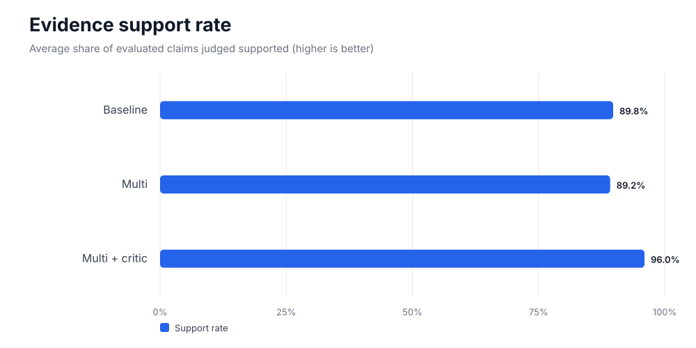
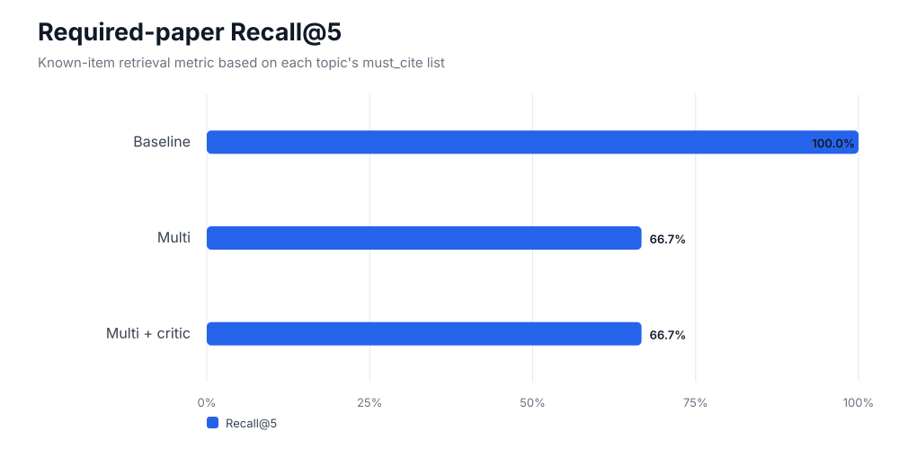
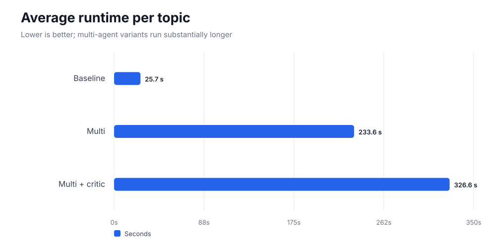
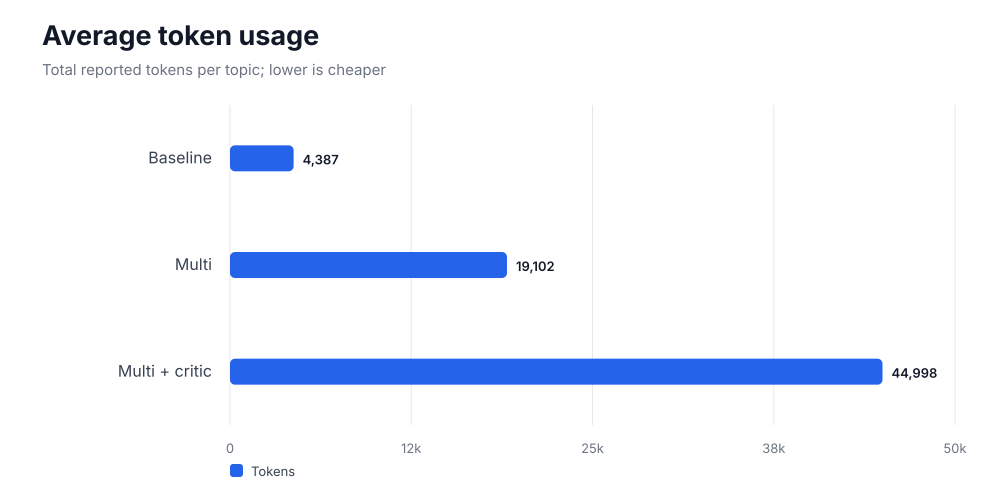
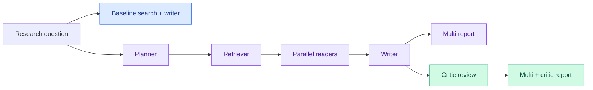

# Research Copilot

A multi-agent system that turns a research question into a **cited
literature review whose citations are checked against the source text**.
Built with LangGraph; runs as a CLI, a Streamlit app, or an HTTP API
with live event streaming.

``` text
question -> Planner -> Retriever -> Reader x N (parallel) -> Writer -> Critic --pass--> report
             ^                                               ^         |
             +---------------- retrieve_more ----------------+---------+ revise_draft
```

  -----------------------------------------------------------------------
| Agent | Job |
|---|---|
| **Planner** | Converts the question into sub-questions and search queries using structured output, sanitization, and a fallback plan. |
| **Retriever** | Searches arXiv and OpenAlex in parallel (optionally Semantic Scholar), deduplicates, ranks for diversity, shortlists, and performs follow-up passes. |
| **Reader (× N)** | Processes PDFs into chunks and a vector store; extracts methods, datasets, metrics, and limitations. |
| **Writer** | Produces an evidence-grounded review; invented citations are stripped and sentences relying only on them are dropped. |
| **Critic** | Checks cited claims against cited passages, reviews coverage, and routes to pass, revise, or retrieve more. |

Details, failure behaviour and limitations:
[docs/ARCHITECTURE.md](docs/ARCHITECTURE.md).

## Quick start

``` bash
python -m venv .venv && source .venv/bin/activate
pip install -r requirements.txt -r requirements-app.txt
pip install sentence-transformers          # real embeddings (bge-small; fine on CPU or a 6 GB GPU)
cp .env.example .env                       # configure GOOGLE_API_KEY and OPENALEX_API_KEY
make test                                  # 81 tests, fully offline (fake LLMs + fake search sources)

make ui                                    # Streamlit app, live agent trace
python -m copilot.cli "gloss-free sign language production" --year-from 2021 --out runs/slp
make api                                   # HTTP API on :8000 (see deploy/API.md)
```

Cheap modes while developing: `--until retrieve` (plan + search, one LLM
call), `--no-fulltext` (abstracts only), `COPILOT_EMBEDDER=hash` (no
model download; not semantic).

## Interfaces

-   **UI** (`ui/app.py`): live, detailed agent trace (reasoning, plan,
    searches, papers chosen and why, per-paper reading, every fact-check
    verdict); tabs for Report, Papers, per-claim Verification, Trace,
    Downloads.
-   **API** (`copilot/service.py`): `POST /runs`,
    `GET /runs/{id}/events` (SSE, resumable), reports as md/html/json.
    Optional `COPILOT_API_KEY`. See [deploy/API.md](deploy/API.md).
-   **CLI** (`copilot/cli.py`): prints every step live (`--brief` for
    one line each); writes `report.md`, `report.html`, `run.json`.

## Deploy

`docker compose up --build` (UI :7860, API :8000) or follow
[deploy/HUGGINGFACE.md](deploy/HUGGINGFACE.md).

**Set `COPILOT_UI_PASSWORD` / `COPILOT_API_KEY` on anything public**:
every run spends LLM tokens. CI (`.github/workflows/ci.yml`) runs ruff +
the offline tests on every push.

## Evaluation

### Benchmark at a glance



The critic-enabled variant has the highest claim-support rate, while the baseline is strongest on known-paper retrieval and efficiency. The charts below make these trade-offs visible.








``` bash
python -m eval.run_eval --topics eval/datasets/slp.json --variants baseline,multi,multi_critic --out eval/results
python -m eval.run_eval ... --no-fulltext --judge-model <a different model than the Critic>
```

Variants:

-   `baseline`: one search, abstracts, one write call.
-   `multi`: multi-agent pipeline without the Critic.
-   `multi_critic`: full multi-agent pipeline with Critic verification
    and revision.


#### How the variants differ




### Latest results: six-topic benchmark

The latest recorded benchmark compares `baseline`, `multi`, and
`multi_critic` on all six topics in `eval/datasets/slp_v2.json`. It used
abstract-only retrieval (`--no-fulltext`), a configured maximum of 20
papers, and `gemini-3.5-flash-lite` as the evaluation judge.

**Run summary**

  -----------------------------------------------------------------------
| Setting | Value |
|---|---|
| Dataset | ISL Sign Language Production Literature Review Evaluation, v2 |
| Topics | 6 |
| Variants | `baseline`, `multi`, `multi_critic` |
| Completed runs | 18 / 18 |
| Failed runs | 0 |
| Claim-judge errors | 0 |
| Full-text fetching | Disabled |
| Maximum papers setting | 20 |
| Evaluation judge | `gemini-3.5-flash-lite` |

#### Aggregate results

| Metric | Baseline | Multi | Multi + Critic |
|---|---:|---:|---:|
| Required-paper pool coverage | **100.0%** | **100.0%** | **100.0%** |
| Required-paper shortlist coverage | **100.0%** | 77.8% | 88.9% |
| Required-paper cited coverage | **100.0%** | 77.8% | 88.9% |
| Precision@5 | **56.7%** | 36.7% | 36.7% |
| Recall@5 | **100.0%** | 66.7% | 66.7% |
| nDCG@5 | **0.970** | 0.642 | 0.517 |
| Precision@10 | **28.3%** | 20.0% | 21.7% |
| Recall@10 | **100.0%** | 72.2% | 77.8% |
| nDCG@10 | **0.970** | 0.670 | 0.569 |
| Precision@20 | **14.2%** | 10.8% | 11.7% |
| Recall@20 | **100.0%** | 77.8% | 83.3% |
| nDCG@20 | **0.970** | 0.688 | 0.589 |
| MRR | **1.000** | 0.731 | 0.545 |
| Mean average precision (MAP) | **0.936** | 0.626 | 0.454 |
| Judged precision@5 | 1.000 | 1.000 | 1.000 |
| Judged recall@5 | **0.500** | 0.375 | 0.375 |
| Judged nDCG@5 | **0.869** | 0.699 | 0.640 |
| Judgment coverage@5 | **80.0%** | 60.0% | 60.0% |
| Mean sub-question coverage | 79.6% | 84.7% | **85.0%** |
| Claim support rate | 89.8% | 89.2% | **96.0%** |
| Papers retrieved, average | **28.5** | 239.2 | 298.2 |
| Papers shortlisted, average | 19.7 | 20.0 | 23.3 |
| Claims evaluated, average | 14.5 | 22.3 | 23.3 |
| Papers cited, average | 9.2 | 13.5 | 13.7 |
| Tokens, average | **4,387** | 19,102 | 44,998 |
| Judge tokens, average | 5,846 | 8,917 | 8,979 |
| Runtime per topic, average | **25.7 s** | 233.6 s | 326.6 s |
| Evaluation/state errors, average | 0 | 0 | 0 |
| Failed runs | 0 | 0 | 0 |

*Coverage metrics use the benchmark's required-paper (`must_cite`)
lists. They measure whether known required papers are retrieved,
shortlisted, and cited; they do not measure the relevance of every
candidate. Precision/recall/nDCG/MRR/MAP are therefore known-item
ranking metrics, not a complete assessment of general search relevance.
Judged metrics use the available relevance labels; five of the six
topics do not have topic-level relevance judgments, so these metrics are
not yet a robust cross-topic comparison.*

#### Results by topic

Each cell shows **required-paper shortlist coverage / claim support
rate**.

  --------------------------------------------------------------------------
| Topic | Baseline | Multi | Multi + Critic |
|---|---:|---:|---:|
| SLP architectures | 100.0% / 89.3% | 100.0% / 93.3% | 100.0% / 95.2% |
| Discrete motion representations | 100.0% / 88.2% | 100.0% / 95.8% | 100.0% / 95.2% |
| ISL datasets and benchmarks | 100.0% / 100.0% | 100.0% / 87.5% | 100.0% / 92.9% |
| SLP evaluation | 100.0% / 79.2% | 66.7% / 60.5% | 100.0% / 97.2% |
| Low-resource ISL production | 100.0% / 100.0% | 33.3% / 100.0% | 33.3% / 100.0% |
| Generalization and motion quality | 100.0% / 82.3% | 66.7% / 97.7% | 100.0% / 95.2% |

#### What the results mean

**1. The candidate pool finds the required papers, but downstream
selection loses some.**

All variants achieved 100% required-paper coverage in the retrieved
pool. The baseline preserved 100% of required papers in its shortlist
and cited report. `multi` retained 77.8%, while `multi_critic` retained
88.9%. This points to a shortlist/ranking/selection problem rather than
a simple failure to retrieve the required items.

The clearest example is **Low-resource ISL production**: both
multi-agent variants retained only one-third of the required papers in
the shortlist and cited report, despite 100% coverage in their candidate
pools. Inspect ranking and filtering between retrieval and writing, and
record why any required paper is excluded.

**2. Baseline has the strongest known-item ranking and lowest cost.**

Baseline achieved 100% Recall@5 and an nDCG@5 of 0.970, compared with
66.7% and 0.642 for `multi`, and 66.7% and 0.517 for `multi_critic`. It
also ran in an average of 25.7 seconds per topic, compared with 233.6
and 326.6 seconds.

**3. The critic variant has the highest claim-support rate, but not the
best overall score.**

`multi_critic` reached a 96.0% average claim-support rate, up from 89.2%
for `multi` and 89.8% for baseline. It also had the highest mean
sub-question coverage (85.0%). However, its ranking metrics were lower
than baseline, and it was the slowest and most token-intensive variant.
Claim support is one dimension of report quality; it does not prove
completeness, relevance, or overall factual correctness.

**4. More retrieval is not automatically better.**

The multi-agent variants retrieved an average of 239 and 298 papers per
topic, versus 29 for baseline. The average shortlist stayed near 20 for
`multi`, but rose to 23.3 for `multi_critic`. If `max_papers=20` is
intended as a strict final limit, investigate whether a later stage adds
papers after the limit is applied.

**5. Relevance judgments are a major evaluation gap.**

Only one of the six topics currently has relevance judgments. Judged
precision@5 is 1.0 for all variants, but judgment coverage is incomplete
and judged recall differs. Add human-verified relevance labels for the
other topics before treating these scores as a general retrieval-quality
comparison. Keep known-item metrics as a separate test of required-paper
retrieval.

#### Recommended next steps

1.  **Protect required papers during selection.** Add regression tests
    to ensure papers found in the pool are not silently dropped during
    ranking, shortlist construction, or report generation.
2.  **Enforce the intended paper limit.** Check whether the critic or
    later stages can append papers after the shortlist limit.
3.  **Fix and measure planner query diversity.** Log the generated
    sub-questions and the exact queries passed to each search source;
    verify that multiple focused queries reach retrieval.
4.  **Add relevance labels for all six topics.** Use topic-specific
    relevance judgments to calculate general precision, recall, nDCG,
    and judgment coverage.
5.  **Run controlled ablations.** Compare baseline, baseline + reranker,
    and baseline + reranker + critic with identical topics and settings.
    Track retrieval quality, claim support, latency, and token usage
    together.

#### Reproducibility

Run the same benchmark with:

``` bash
uv run python -u -m eval.run_eval \
  --topics eval/datasets/slp_v2.json \
  --variants baseline,multi,multi_critic \
  --out eval/results/all-variants \
  --no-fulltext
```

The run writes `results.md`, `results.json`, `run_eval.log`, metadata,
and per-topic artifacts under the output directory. The benchmark judge
is configured through `--judge-model`; for stronger independence, use a
judge model different from the Critic's model and manually audit a
sample of claim-support verdicts.

## Project layout

-   `copilot/graph`: state, routing, workflow
-   `copilot/agents`: the five agents (planner, retriever, reader,
    writer, critic)
-   `copilot/tools`: arXiv, OpenAlex, Semantic Scholar, PDF extraction,
    chunking, embeddings, vector store, MMR re-ranking
-   `copilot/factory.py`: shared resources and search adapters
-   `copilot/service.py`: HTTP API and event streaming
-   `copilot/render.py`: markdown and HTML report generation
-   `copilot/baseline.py`: baseline single-pass implementation
-   `ui/`: Streamlit interface with live agent trace inspection
-   `eval/`: evaluation harness, ranked retrieval metrics (Precision@k,
    Recall@k, nDCG@k, MRR, MAP, subquestion coverage), and benchmark
    datasets
-   `deploy/`: deployment configuration (Docker, Hugging Face, HTTP API)
-   `docs/`: architecture and project documentation

## Status

-   **Tested offline**: 81 automated tests passing covering pipeline
    graphs, loops, API, UI, MMR re-ranking, and retrieval/evaluation
    metrics.
-   **Exercised against live services**: Validated against live Gemini
    LLMs (Gemini 3.5 Flash Lite), arXiv, and OpenAlex.
-   **Evaluation framework**: Full ranked-retrieval metrics suite
    (Precision@k, Recall@k, nDCG@k, MRR, MAP, subquestion coverage,
    claim support rate).
-   Not built (stretch): Gap Finder agent, human-in-the-loop paper
    approval, citation-graph expansion.