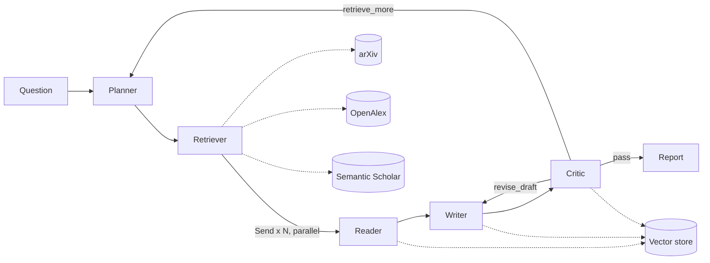

# Architecture

## Contracts
All agents communicate through one typed `CopilotState` (`copilot/graph/state.py`). Parallel-safe fields have
reducers (`papers` merges duplicates, `notes` merges per-paper results, `usage`/`trace`/`errors` accumulate).
Node names never equal state keys (LangGraph restriction), hence `critique` (key) vs `critic_agent` (node).

## Grounding chain (why citations can be trusted, and where they cannot)
1. **Reader** stores every passage as a `Chunk` with a stable id `<paper_id>#<n>` (or `#abs`).
2. **Writer** sees only labelled evidence (`[C1]...`) retrieved per sub-question. Aliases are mapped back to real
   chunk ids; an alias that does not exist is stripped, and a sentence resting *only* on invented aliases is
   dropped (`Draft.stripped_citations` records how often this happens, which is itself an eval metric).
3. **Critic** treats each cited sentence as a claim and judges it against only the chunks it cites.
4. **Report** shows `[n]` numbers per paper; the table of methods/datasets/metrics comes from Reader notes,
   not from the Writer, so it cannot be hallucinated by the prose step.

Not covered: uncited sentences are not verified (the Writer is instructed to cite every factual sentence, but
nothing enforces it), and the judge is an LLM, so a verdict is evidence, not proof. Spot-check it.

## Loop control
`critic -> planner -> retriever` (retrieve_more) and `critic -> writer` (revise_draft) are bounded by
`max_iterations` (default 2) and `max_total_tokens` (default 400k). When the budget is exhausted the Critic
returns `action=pass, passed=False`: the run finishes with an honest "quality bar not met" flag rather than looping.
A follow-up retrieval only runs queries not yet searched, only reads papers without notes, and appends to the
shortlist instead of reshuffling it.

## Failure behaviour
| Failure | Behaviour |
|---|---|
| Planner LLM error / unparseable output | fallback plan = search the raw question; logged in `errors` |
| One search source down or rate-limited | retried with backoff; if still failing, logged, other source continues |
| PDF missing / unparseable | Reader falls back to the abstract for that paper |
| Reader extraction fails | notes contain the abstract's first sentences only; logged |
| Judge call fails | affected claims marked unsupported ("judge call failed"), never silently passed |
| No papers found | run ends with an explicit error, no draft |
| API run fails | status `error` with the exception; SSE stream ends with a `done` event |

## Cost / latency levers
Configurable LLMs per agent role (Planner, Reader, Writer, Critic) with rate limiting (`COPILOT_LLM_RPM`).
Reader fan-out is parallel, so wall-clock is bounded by external API etiquette (arXiv 3 s/request, OpenAlex
polite pool / API key). Everything fetched is cached on disk; embeddings of already-read papers are reused through
the shared vector store. `--until retrieve` costs one LLM call; `--no-fulltext` reads abstracts only.

## Retrieval and Ranking
- **Multi-source search**: Queries arXiv with dual-field targeting (title and abstract) and OpenAlex via their
  structured search API with polite pool support. Optional Semantic Scholar fallback.
- **MMR Re-ranking**: Maximal Marginal Relevance balances relevance score (query overlap, citation weight,
  recency dampening, subquestion alignment) against candidate redundancy (Jaccard token similarity) using `lambda_mult=0.7`.
- **Ranked evaluation metrics**: The eval suite reports Mean Subquestion Coverage, Precision@k, Recall@k,
  nDCG@k, MRR, Mean Average Precision (MAP), and Claim Support Rate.

## Known limitations
- Primary academic sources are arXiv and OpenAlex (with optional Semantic Scholar). Non-indexed regional venues
  require implementing custom adapters behind `SearchFn`.
- PDF text extraction is plain text: tables, equations, and figures are lost; first 15 pages only.
- Token usage is tracked; dollar cost is not.
- The vector store lives in memory; the API keeps the 50 most recent runs in memory (all runs are persisted to disk).
