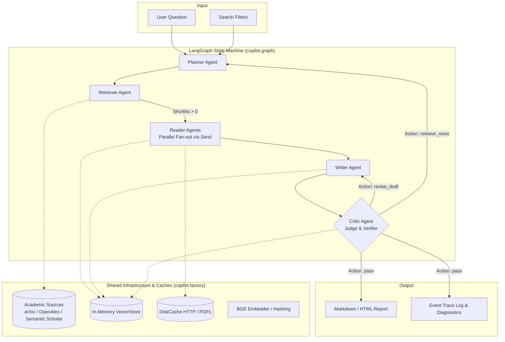

# Architecture & System Design

`research-copilot` is a multi-agent system designed to take a high-level research question and produce a fully cited, claim-verified academic literature review report.

## High-Level Architecture

The system coordinates specialized agent roles orchestrated by a typed [LangGraph](https://github.com/langchain-ai/langgraph) state machine.

---

## Core Subsystems

### 1. Graph Orchestration & Typed State
- **Module**: [copilot/graph/state.py](file:///home/prime/Desktop/Projects/research-copilot/copilot/graph/state.py), [copilot/graph/routing.py](file:///home/prime/Desktop/Projects/research-copilot/copilot/graph/routing.py), [copilot/graph/workflow.py](file:///home/prime/Desktop/Projects/research-copilot/copilot/graph/workflow.py)
- **State Contract (`CopilotState`)**: Agents communicate exclusively through `CopilotState`. Node names never match state keys (e.g. `critic_agent` node vs `critique` key).
- **Parallel Reducers**:
  - `papers: Annotated[dict[str, Paper], merge_papers]`: deduplicates and merges paper metadata from multiple search queries and sources.
  - `notes: Annotated[dict[str, PaperNotes], merge_dicts]`: allows parallel Reader branches to return notes simultaneously without race conditions.
  - `searched_queries: Annotated[list[str], operator.add]`: prevents redundant search queries across retrieval loops.
  - `usage: Annotated[Usage, merge_usage]`: aggregates token counts and LLM call counts across all agents.
  - `trace: Annotated[list[TraceEvent], operator.add]`: accumulates real-time progress events.
  - `errors: Annotated[list[str], operator.add]`: non-fatal error logging.
- **Routing & Budget Guards**:
  - `budget_exceeded()`: terminates iterative loops if total token consumption exceeds `max_total_tokens` (default 400,000).
  - `iterations_left()`: enforces `max_iterations` (default 2) on critic loops.
  - `route_after_retriever()`: dynamically fans out `Send("reader", ...)` for unread shortlisted papers.
  - `route_after_critic()`: directs flow to `END`, `writer`, or `planner`.

### 2. Multi-Agent Roles
- **Planner** ([copilot/agents/planner.py](file:///home/prime/Desktop/Projects/research-copilot/copilot/agents/planner.py)):
  - Deconstructs research queries into structured `SubQuestion` items and search queries.
  - Provides a deterministic `fallback_plan()` if LLM output fails validation.
- **Retriever** ([copilot/agents/retriever.py](file:///home/prime/Desktop/Projects/research-copilot/copilot/agents/retriever.py)):
  - Executes parallel search queries across configured sources (`arXiv`, `OpenAlex`, optional `Semantic Scholar`).
  - Merges duplicate candidate papers using canonical ID resolution (DOI > arXiv > Semantic Scholar > normalized title hash).
  - Performs Maximal Marginal Relevance (MMR) re-ranking to balance query overlap, citation count, publication recency, and token diversity.
- **Reader** ([copilot/agents/reader.py](file:///home/prime/Desktop/Projects/research-copilot/copilot/agents/reader.py)):
  - Runs in parallel per shortlisted paper.
  - Fetches and parses full-text PDFs (falling back to abstracts if PDFs are missing or unparseable).
  - Extracts structured `PaperNotes` (problem, method, datasets, metrics, key findings, limitations).
  - Chunks text and registers chunks in the shared `VectorStore` under `<paper_id>#<n>` and `<paper_id>#abs`.
- **Writer** ([copilot/agents/writer.py](file:///home/prime/Desktop/Projects/research-copilot/copilot/agents/writer.py)):
  - Queries `VectorStore` for top evidence chunks per sub-question.
  - Maps evidence chunks to short aliases (`[C1]`, `[C2]`).
  - Generates cohesive literature review markdown.
  - Resolves aliases back to stable `<paper_id>#<n>` tags, automatically stripping fabricated or invalid citations.
- **Critic** ([copilot/agents/critic.py](file:///home/prime/Desktop/Projects/research-copilot/copilot/agents/critic.py)):
  - Fact-checks every cited sentence as a testable claim strictly against the specific text chunks cited.
  - Verifies topic coverage against planned subquestions.
  - Decides whether to pass, request prose revision (`revise_draft`), or retrieve additional literature (`retrieve_more`).

### 3. Shared Resource Management & Factory
- **Module**: [copilot/factory.py](file:///home/prime/Desktop/Projects/research-copilot/copilot/factory.py)
- **`CopilotFactory`**: Long-lived singleton in service/UI processes that maintains:
  - Shared search client rate limiters (e.g. arXiv 1 req / 3s).
  - Shared PDF fetcher and HTTP disk cache.
  - Singleton embedding model (`bge-small-en-v1.5` or `hashing`).
  - Singleton `VectorStore` so papers read in previous runs remain indexed in memory.

### 4. Evaluation Suite & Metrics
- **Module**: [eval/metrics.py](file:///home/prime/Desktop/Projects/research-copilot/eval/metrics.py), [eval/run_eval.py](file:///home/prime/Desktop/Projects/research-copilot/eval/run_eval.py)
- Compares pipeline variants (`baseline`, `retrieve`, `write`, `critic`) across:
  - Mean Subquestion Coverage
  - Precision@k, Recall@k, nDCG@k, MRR, Mean Average Precision (MAP)
  - Claim Support Rate and Stripped Citation Count
