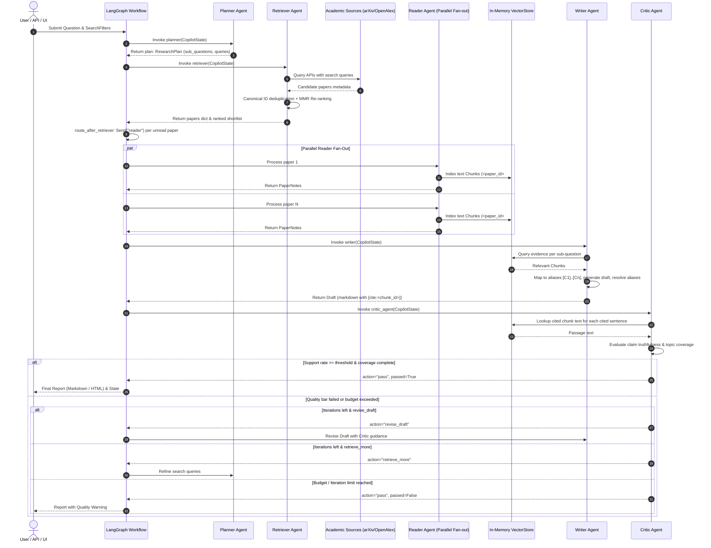

# Data Flow & Execution Lifecycles

This document details the lifecycle of research queries through the multi-agent graph, data contracts between stages, parallel fan-out mechanics, and citation grounding guarantees.

---

## 1. End-to-End Data Pipeline

---

## 2. Stage-by-Stage Data Transformation

### Step 1: Initialization
- **Function**: `make_initial_state(question, filters)` in [copilot/graph/state.py](../../copilot/graph/state.py)
- **State Injected**:
  - `question: str`: sanitized user research question.
  - `filters: SearchFilters`: optional constraints (`year_from`, `year_to`, `max_papers`).
  - `iteration: 0`: loop counter.

### Step 2: Planning Stage
- **Input**: `question`, `filters`
- **Agent**: [copilot/agents/planner.py](../../copilot/agents/planner.py)
- **Transformation**:
  - LLM receives structured system prompt with academic search guidelines.
  - Emits JSON matching `PlannerOutput` schema containing 3–5 `SubQuestion` items, each with 2–3 targeted boolean academic search queries.
  - If LLM generates invalid JSON or fails, `fallback_plan()` provides deterministic raw query fallback without breaking the pipeline.
- **Output State**: `plan: ResearchPlan(sub_questions=[...], scope_notes="...")`.

### Step 3: Multi-Source Retrieval & Deduplication
- **Input**: `plan.all_queries()`, `filters`, `searched_queries`
- **Agent**: [copilot/agents/retriever.py](../../copilot/agents/retriever.py)
- **Transformation**:
  - Filters out queries already in `searched_queries` (to avoid redundant API calls on retry loops).
  - Queries `arXiv` (XML Atom API) and `OpenAlex` (JSON REST API) concurrently using `ThreadPoolExecutor`.
  - Canonical ID mapping via `compute_paper_id()`:
    1. `arxiv:<id>`
    2. `doi:<normalized_doi>`
    3. `s2:<semantic_scholar_id>`
    4. `title:<short_hash(normalized_title)>`
  - Duplicate candidates are merged using `Paper.merged_with()`, combining citation metrics, sources, and rich abstracts.
  - **MMR (Maximal Marginal Relevance) Re-ranking**:
    - Computes relevance score based on query term overlap, citation weight, recency dampening, and subquestion match.
    - Balances relevance against candidate redundancy using Jaccard token similarity with diversity multiplier `lambda_mult=0.7`.
- **Output State**:
  - `papers: Annotated[dict[str, Paper], merge_papers]`: pool of discovered papers.
  - `shortlist: list[str]`: top `max_papers` (default 20) ranked paper IDs.
  - `searched_queries: list[str]`: updated list of executed queries.

### Step 4: Parallel Reading & VectorStore Indexing
- **Branching**: `route_after_retriever` identifies paper IDs in `shortlist` lacking notes in `state["notes"]`. Fans out using `Send("reader", {"paper": p, "question": q})`.
- **Agent**: [copilot/agents/reader.py](../../copilot/agents/reader.py)
- **Transformation per Paper**:
  - Attempts PDF download via `PdfFetcher` (HTTP disk cache with 7-day TTL).
  - Falls back to abstract if PDF is unavailable or unparseable.
  - Splits text into sliding window passages via `chunk_pages()` (default 1,000 characters, 150-char overlap, max 40 chunks per paper).
  - Inserts chunks into `VectorStore` under stable identifiers: `<paper_id>#<n>` and `<paper_id>#abs`.
  - LLM reads the top passages and generates structured `PaperNotes`:
    - `problem`: core challenge addressed.
    - `method`: technical solution proposed.
    - `datasets`: benchmark datasets used.
    - `metrics`: numerical evaluation results.
    - `key_results`: summary findings.
    - `limitations`: acknowledged weaknesses.
- **Output State**: `notes: Annotated[dict[str, PaperNotes], merge_dicts]`.

### Step 5: Evidence Synthesis & Writer
- **Input**: `notes`, `shortlist`, `plan`
- **Agent**: [copilot/agents/writer.py](../../copilot/agents/writer.py)
- **Transformation**:
  - For each sub-question, queries `VectorStore` to retrieve the top 5 most relevant evidence chunks across all read papers (capped at `max_evidence_chunks=24`).
  - Assigns temporary short aliases to evidence chunks (e.g. `[C1]`, `[C2]`) to facilitate LLM citation accuracy.
  - Prompt instructs LLM to produce structured literature review markdown where every factual assertion references one or more aliases.
  - Post-processing citation resolution:
    - Replaces aliases with permanent canonical tags: `[cite:<chunk_id>]`.
    - **Hallucination Stripping**: Detects any alias invented by the LLM that was not in the provided evidence. If an alias is invalid, it is stripped. Sentences relying exclusively on hallucinated citations are automatically removed, and `stripped_citations` counter is incremented.
- **Output State**: `draft: Draft(markdown="...", cited_chunk_ids=[...], stripped_citations=N)`.

### Step 6: Claim-Level Verification & Critic Loop
- **Input**: `draft`, `plan`
- **Agent**: [copilot/agents/critic.py](../../copilot/agents/critic.py)
- **Transformation**:
  - `split_claims()` parses every cited sentence from `draft.markdown`.
  - For each claim, retrieves the exact passage text of its cited chunk IDs from `VectorStore`.
  - Sends batches of (claim, passage) pairs to the Critic LLM (`verify_claims`).
  - Each claim receives a verdict:
    - `supported`: claim is directly verified by the cited passage.
    - `partial`: claim is partially true or extrapolates beyond the passage.
    - `unsupported`: claim contradicts or is absent from the passage.
  - Checks sub-question coverage to identify missing topics.
  - Decision Logic:
    - If `support_rate >= support_threshold` (default 0.85) and no major topics missing -> `action="pass", passed=True`.
    - If support rate low and iterations remain -> `action="revise_draft"`.
    - If key topics unaddressed and iterations remain -> `action="retrieve_more"`.
    - If token budget or iteration limit reached -> `action="pass", passed=False` (run terminates with explicit warning).
- **Output State**: `critique: CriticReport(...)`.

### Step 7: Final Rendering & Persistence
- **Module**: [copilot/render.py](../../copilot/render.py)
- **Transformation**:
  - Replaces `[cite:<chunk_id>]` tokens with human-readable paper number citations `[n]` referencing the bibliography.
  - Generates a summary comparison table of problems, methods, datasets, and metrics directly from Reader `PaperNotes` (preventing prose hallucination).
  - Saves run artifacts to disk (`report.md`, `report.html`, `run.json`).
