# Module Dependency Graph & Coupling Intelligence

This document details the module-level dependency structure, coupling metrics, reverse dependencies, and architectural layer boundaries of `research-copilot`.

## Architecture Layers & Dependency Direction

The codebase adheres to a unidirectional dependency hierarchy:

```
[Entry Points & Frontends] (ui/app.py, copilot/service.py, copilot/cli.py, eval/run_eval.py)
           │
           ▼
[Factory & Orchestration] (copilot/factory.py, copilot/graph/workflow.py, copilot/graph/routing.py)
           │
           ▼
[Agent Implementations]   (copilot/agents/{planner, retriever, reader, writer, critic}.py)
           │
           ▼
[Domain Tools & Adapters] (copilot/tools/{arxiv, openalex, pdf, chunking, embeddings, vectorstore, ranking}.py)
           │
           ▼
[Foundation & State]      (copilot/graph/state.py, copilot/config.py, copilot/utils.py)
```

**Circular Dependency Analysis**:
- Cycle Detection: **0 circular imports detected** (verified via AST analysis in `scripts/codebase_map.py`).
- Topology: Strict Directed Acyclic Graph (DAG).

---

## Complete Module Dependency Diagram

```mermaid
graph TD
    subgraph UI_and_Service["Interfaces & Entrypoints"]
        ui_app["ui.app"]
        copilot_service["copilot.service"]
        copilot_cli["copilot.cli"]
        eval_run_eval["eval.run_eval"]
        eval_verify_dataset["eval.verify_dataset"]
    end

    subgraph Factory_and_Workflow["Factory & Workflow Layer"]
        copilot_factory["copilot.factory"]
        copilot_graph_workflow["copilot.graph.workflow"]
        copilot_graph_routing["copilot.graph.routing"]
        copilot_baseline["copilot.baseline"]
    end

    subgraph Agents["Agents Layer"]
        copilot_agents_planner["agents.planner"]
        copilot_agents_retriever["agents.retriever"]
        copilot_agents_reader["agents.reader"]
        copilot_agents_writer["agents.writer"]
        copilot_agents_critic["agents.critic"]
    end

    subgraph Tools["Tools & Retrieval Layer"]
        copilot_tools_sources["tools.sources"]
        copilot_tools_arxiv["tools.arxiv"]
        copilot_tools_openalex["tools.openalex"]
        copilot_tools_semantic_scholar["tools.semantic_scholar"]
        copilot_tools_pdf["tools.pdf"]
        copilot_tools_chunking["tools.chunking"]
        copilot_tools_vectorstore["tools.vectorstore"]
        copilot_tools_embeddings["tools.embeddings"]
        copilot_tools_ranking["tools.ranking"]
        copilot_tools_papers["tools.papers"]
        copilot_tools_http["tools.http"]
    end

    subgraph Core_and_State["Core State & Foundation"]
        copilot_graph_state["copilot.graph.state"]
        copilot_config["copilot.config"]
        copilot_llm["copilot.llm"]
        copilot_progress["copilot.progress"]
        copilot_render["copilot.render"]
        copilot_utils["copilot.utils"]
        eval_metrics["eval.metrics"]
    end

    ui_app --> copilot_factory
    ui_app --> copilot_config
    ui_app --> copilot_graph_state
    ui_app --> copilot_progress
    ui_app --> copilot_render

    copilot_service --> copilot_factory
    copilot_service --> copilot_config
    copilot_service --> copilot_graph_state
    copilot_service --> copilot_render

    copilot_cli --> copilot_graph_workflow
    copilot_cli --> copilot_config
    copilot_cli --> copilot_graph_state
    copilot_cli --> copilot_progress
    copilot_cli --> copilot_render

    copilot_factory --> copilot_graph_workflow
    copilot_factory --> copilot_tools_sources
    copilot_factory --> copilot_tools_embeddings
    copilot_factory --> copilot_tools_vectorstore

    copilot_graph_workflow --> copilot_agents_planner
    copilot_graph_workflow --> copilot_agents_retriever
    copilot_graph_workflow --> copilot_agents_reader
    copilot_graph_workflow --> copilot_agents_writer
    copilot_graph_workflow --> copilot_agents_critic
    copilot_graph_workflow --> copilot_graph_routing

    copilot_agents_critic --> copilot_tools_chunking
    copilot_agents_reader --> copilot_tools_chunking
    copilot_agents_reader --> copilot_tools_vectorstore
    copilot_agents_retriever --> copilot_tools_sources
    copilot_agents_retriever --> copilot_tools_ranking
    copilot_agents_retriever --> copilot_tools_papers
    copilot_agents_writer --> copilot_tools_chunking
    copilot_agents_writer --> copilot_tools_vectorstore

    copilot_tools_sources --> copilot_tools_arxiv
    copilot_tools_sources --> copilot_tools_openalex
    copilot_tools_sources --> copilot_tools_http
    copilot_tools_vectorstore --> copilot_tools_embeddings
    copilot_tools_pdf --> copilot_tools_http
    copilot_tools_arxiv --> copilot_tools_http
    copilot_tools_openalex --> copilot_tools_http

    copilot_graph_state --> copilot_utils
    copilot_tools_arxiv --> copilot_utils
    copilot_tools_openalex --> copilot_utils
    copilot_tools_ranking --> copilot_utils
    copilot_tools_embeddings --> copilot_utils
```



---

## Reverse Dependencies & Coupling Metrics

The table below shows the coupling metrics for key internal modules:
- **Fan-In (Incoming / Reverse Dependencies)**: Number of modules importing this module. High fan-in indicates an architectural foundation or common contract; changes here have a wide blast radius.
- **Fan-Out (Outgoing Dependencies)**: Number of internal modules imported by this module.

| Module | Fan-In (Reverse Dependencies) | Fan-Out | Reverse Dependencies (Importers) |
|---|---|---|---|
| `copilot.graph.state` | 22 | 1 | All agents, workflow, service, cli, tools, render, eval |
| `copilot.config` | 11 | 0 | agents (retriever, reader, writer, critic), factory, service, cli, workflow, routing, sources |
| `copilot.tools.http` | 6 | 0 | arxiv, openalex, semantic_scholar, pdf, sources, workflow |
| `copilot.progress` | 6 | 1 | planner, retriever, reader, writer, critic, cli |
| `copilot.tools.chunking` | 5 | 1 | reader, writer, critic, baseline, render |
| `copilot.utils` | 5 | 0 | state, arxiv, openalex, ranking, embeddings |
| `copilot.llm` | 5 | 1 | planner, reader, writer, critic, workflow |
| `copilot.tools.vectorstore` | 4 | 2 | reader, writer, factory, workflow |
| `copilot.tools.sources` | 4 | 5 | retriever, baseline, factory, workflow |
| `copilot.tools.embeddings` | 3 | 1 | vectorstore, factory, workflow |
| `copilot.graph.workflow` | 2 | 14 | cli, factory |
| `copilot.render` | 2 | 2 | cli, service |
| `copilot.graph.routing` | 2 | 2 | critic, workflow |
| `copilot.factory` | 2 | 5 | service, ui.app |
| `copilot.agents.retriever` | 2 | 6 | baseline, workflow |
| `copilot.agents.writer` | 2 | 6 | baseline, workflow |
| `copilot.agents.planner` | 1 | 3 | workflow |
| `copilot.agents.reader` | 1 | 6 | workflow |
| `copilot.agents.critic` | 1 | 6 | workflow |
| `copilot.tools.arxiv` | 1 | 3 | sources |
| `copilot.tools.openalex` | 1 | 3 | sources |
| `copilot.tools.pdf` | 1 | 2 | workflow |
| `copilot.tools.papers` | 1 | 1 | retriever |
| `copilot.tools.ranking` | 1 | 2 | retriever |
| `copilot.service` | 0 | 4 | (None - runtime entry point) |
| `copilot.cli` | 0 | 5 | (None - runtime entry point) |
| `ui.app` | 0 | 5 | (None - runtime entry point) |
| `eval.run_eval` | 0 | 7 | (None - runtime entry point) |

---

## Dynamic & Runtime Dependencies

Some dependencies cannot be fully identified from static top-level imports alone:

1. **LLM Provider Backends** (`copilot/llm.py`):
   - `langchain_google_genai.ChatGoogleGenerativeAI` is dynamically resolved at runtime when `model_provider="google_genai"`.
   - `langchain_anthropic.ChatAnthropic` is loaded when `model_provider="anthropic"`.
   - `COPILOT_LLM_RPM` dynamically attaches an in-memory token-bucket rate limiter.
2. **Embedding Model Weights** (`copilot/tools/embeddings.py`):
   - When `COPILOT_EMBEDDER="bge"`, `sentence_transformers.SentenceTransformer` is imported lazily and downloads `BAAI/bge-small-en-v1.5` from Hugging Face Hub (cached under `~/.cache/huggingface/`).
   - When `COPILOT_EMBEDDER="hash"`, a deterministic local MD5 token hashing embedder is used (no PyTorch/model weights required).
3. **PDF Text Extraction** (`copilot/tools/pdf.py`):
   - Uses `pymupdf` (C-extension binary `fitz`) at runtime to read in-memory byte streams of downloaded PDFs.
4. **FastAPI Background Threads** (`copilot/service.py`):
   - Executes `Copilot.run_live()` inside a `concurrent.futures.ThreadPoolExecutor` worker thread, streaming event dicts over thread-safe `threading.Condition` queues to HTTP clients.
